  <a href="https://athomon.com">
    <picture>
      <source media="(prefers-color-scheme: dark)" srcset="https://raw.githubusercontent.com/MuriloDPV/MuriloDPV/main/assets/nucleo-dark.svg">
      
    </picture>
  </a>

  

<strong>FOX Studio</strong>: an orchestrator for AI agents, designed for the day the agent is wrong. <a href="https://github.com/MuriloDPV/fox-studio-vitrine">See the showcase</a>.

